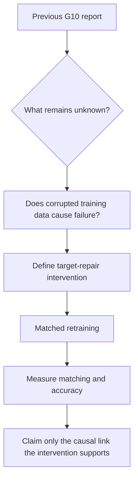

# Next stage plan — approval checkpoint (14 October 2026)

**Status:** Scientific and engineering plan only. No coding model has been instructed; no new transformer has been trained; the historical private archive has not been modified.

## Why there is only one notebook

The official assignment, pp. 4–5, requires the Singh-style ICL task, both Base and Extended recursion, train/validation/test evaluations, and interpretation of embeddings/attention/circuits. It does **not** mandate an image-gallery notebook or any number of notebooks. The original published HDF5 gives the precomputed image embeddings already. Visual browsing of handwritten characters is optional, so this repository retains only `notebooks/01_explore_omniglot.ipynb`.

**Notebook 1 alone cannot perform ablations yet.** Attention-head ablation requires a trained model, checkpoint loader, forward-pass intervention hooks, clean evaluation examples, and unit tests. We propose building those as Python modules and displaying their outputs *inside Notebook 1*. The source code stays testable outside the notebook.

## Actual audited repository state

| Area | State as of 14 October |
| --- | --- |
| HDF5 original Omniglot embeddings | VERIFIED: upstream submodule at commit `85b895c...`, original Git blob SHA `9eb588...`, 16,638,016 bytes |
| Data structure | VERIFIED: `resnet18/224/feat` 1,623 × 5 × 512 float32 and an additional `class_order` permutation |
| Real-data exploratory results | VERIFIED by successful GitHub Actions: 5 plots, JSON summaries, data-only cosine matching controls |
| Active interactive notebooks | ONE: `notebooks/01_explore_omniglot.ipynb` |
| Original publication code | AVAILABLE: upstream `models.py`, `samplers.py`, `main.py`, `opto.py`, reproducibility shell scripts and plotting notebooks |
| Historical symbolic study | EXISTING in private `huziibee/nlp_ass_1`; phase 2–6 code, checkpoints and already-open final test; not imported here |
| Model training in **this** workspace | NOT DONE |
| Base / Extended recursion in **this** workspace | NOT DONE |
| Causal data-repair experiment | NOT DONE |
| Final PDF, contribution statement, ethics declarations | NOT DONE |

### Known results from the private archive (previous study, not new confirmation)

The historical reports describe a 50-symbol, five-label symbolic ICL task in a 2-layer, 8-head attention-only transformer, with G0–G10 recursive target replacement. They report **larger Extended recursive degradation** than Base, and that oracle-corrected attention matching can substantially repair Extended errors. The old test was already seen and cannot become a fresh confirmatory test.

### Critical code-level qualification

Review of the historical `phase3_pipeline.py` verifies that the input `rows_prefix(tr)` remains the same clean context array at every generation. In both Base and Extended conditions, the generated **target continuations** change, not the source context inputs. Therefore the historical experiment rigorously addresses **recursive training-target feedback**, not full recursive input-context generation. Scientific claims and the written method must say so.

## Scientific focus

> **Does recursive corruption of generated output continuations cause a later failure of induction matching, or do corruption and matching failures merely occur together?**

A convincing answer needs to intervene on *training data*, train matched new models, and assess their circuit function. Previously used **test-time forced-match interventions** demonstrate a model's behavioural bottleneck; they do not resolve what caused it during learning.

## Stage 1 — Reproducibility and task-contract audit

**Deliverable:** a source-to-claim table and passing unit tests, *not new model results*.

- Run or port tests from the previous symbolic implementation without changing the old sealed archive.
- Verify its train/validation/final-test protocols, checkpoint loading, and available intervention machinery.
- Confirm whether all outputs of the Extended generator are stored as target continuations (and which positions are teacher-forced).
- Decide whether to run a small literal Omniglot-feature reproduction as additional protection against the PDF's "exact task" wording.
- Clarify the phrase "adding synthetic data": the archive uses **full synthetic replacement**; the assignment describes more synthetic material accumulating over generations.

**Exit gate:** working, auditable code foundation, no unnoticed mismatch between the assignment and proposed claims.

## Stage 2 — Freeze one intervention before training

**Primary proposal:** use an archived synthetic source at a preselected generation (e.g., G9 to create a G10-matched dataset) and construct a matched **raw synthetic** versus **context-valid corrected continuation** comparison. For an invalid next symbol, a context-based oracle cannot assign its label. Therefore a defensible *joint repair* must both choose a legal contextual symbol by a prespecified rule and assign the corresponding original contextual label.

**Optional diagnostic:** independently correct the second label **only where the generated next symbol was already valid**. This isolates a narrower conditional label-noise effect; it is not a clean full-factorial intervention over invalid outputs.

**Required controls:** matched initialization, training order, data volume, loss weights, compute budget, no new test exposure, fixed clean and fixed-G0 synthetic comparisons, and at least three independent seeds (five if feasible).

**Primary outcomes:** held-out clean first/second-value accuracy or log loss, next-symbol contextual validity, matched query-to-label attention strength, and effect of correct-match intervention. Report per-seed effects and negative results.

**Exit gate:** protocol is explicit, test leakage eliminated, repair rule has oracle unit tests.

## Stage 3 — Implement reusable experiment code

**Proposed code boundaries (await approval):**

- `src/task_contracts.py`: source task, train/validation/test policies, repair semantics and oracle invariants.
- `src/reuse_baseline.py`: adapter to retained symbolic model (or original feature baseline if lecturer requires it).
- `src/synthetic_interventions.py`: raw and repaired target datasets, per-example provenance, unit tests.
- `src/retrain.py`: matched retraining and seed/compute recording.
- `src/circuit_analysis.py`: head ablation, keep-only, correct-match repair and random-head controls.
- `src/results.py`: seed-level comparisons and figures.
- Notebook 1 only **loads and displays** those measurements.

Do **not** copy the private archived dataset, private course PDFs, or unlicensed third-party source code into this public workspace without provenance/licence review.

## Stage 4 — Pilot and full comparison

Begin with an extremely small *sanity pilot* to verify target validity and intervention direction. Confirm that G1 fixed-versus-recursive identity remains correct where relevant; this is a valuable pipeline test from the previous study.

Then freeze the final protocol and run the necessary independent replicates, not an open-ended parameter search designed to produce a desired effect. Use validation for all diagnostics and any head selection.

## Stage 5 — Mechanistic interpretation and submission

### What outcomes mean

| Observation | Supported interpretation | NOT automatically supported |
| --- | --- | --- |
| Corrected continuations improve held-out ICL and match quality | Data structure **under this repair intervention** contributes to the failure | Every component of synthetic feedback is explained |
| Accuracy improves but natural matching does not | Data intervention affects behaviour through some other pathway or mixed effect | Induction matching caused the gain |
| Attention repair rescues the model but data repair does not | Matching is a within-model bottleneck, but selected corruption was not shown causal | Synthetic corruption is irrelevant under all settings |
| Distribution skews but behaviour remains stable | Robustness/dissociation under tested conditions | Model collapse is impossible in general |
| No reliable differences | A bounded negative finding, subject to power and implementation checks | Hypothesis disproved universally |

**Submission guardrails:** Two-page main abstract (figures/equations included), unlimited reference/contribution pages, NeurIPS ethics questionnaire, Faculty of Science AI ethics statement, code, requirements.txt, README.txt. The brief sets 27 October 2026, 17:00.

### Provisional calendar
| Window | Goal |
| --- | --- |
| 15–16 Oct | Approve exact research scope; audit archived code and task fidelity |
| 17–19 Oct | Build/reproduce small baseline and validate data-repair semantics |
| 20–23 Oct | Matched retraining, replication and circuit analyses |
| 24–25 Oct | Scientific interpretation, uncertainty, limitations and figures |
| 26 Oct | Write/finalise two-page abstract, contributions and ethics |
| 27 Oct | Exact reproduction instructions, package and submit before 17:00 |

**Approval gate:** agree on whether the project will use the archived symbolic task alone or also a literal Omniglot baseline, whether target replacement meets the lecturer's "adding" requirement, and which data repair is primary. Then delegate independent coding workstreams. No prompts to coding models are issued before approval.
