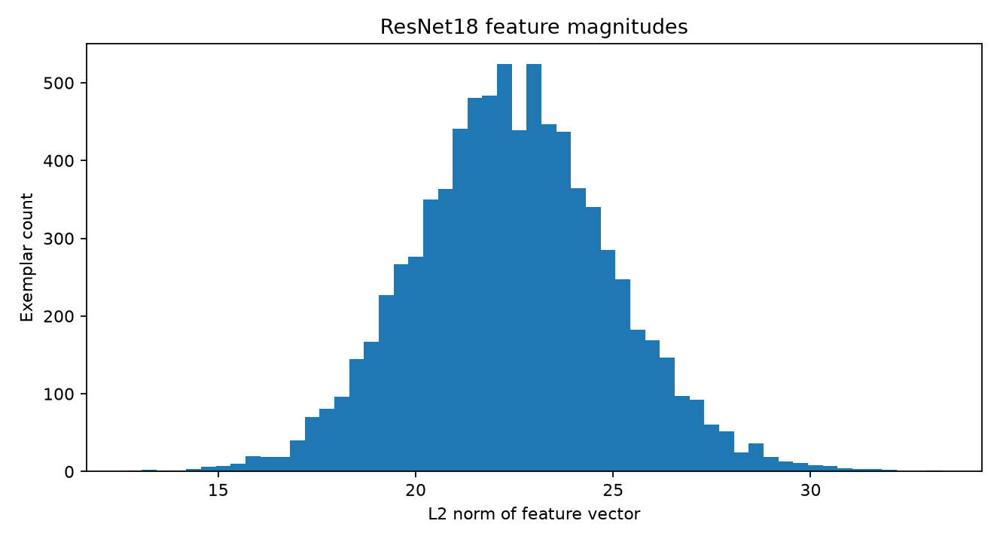
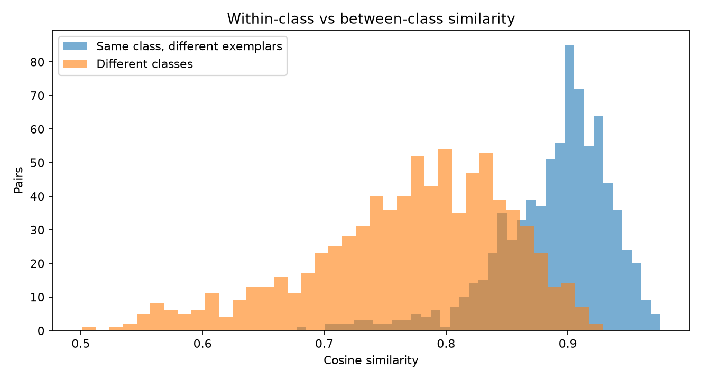
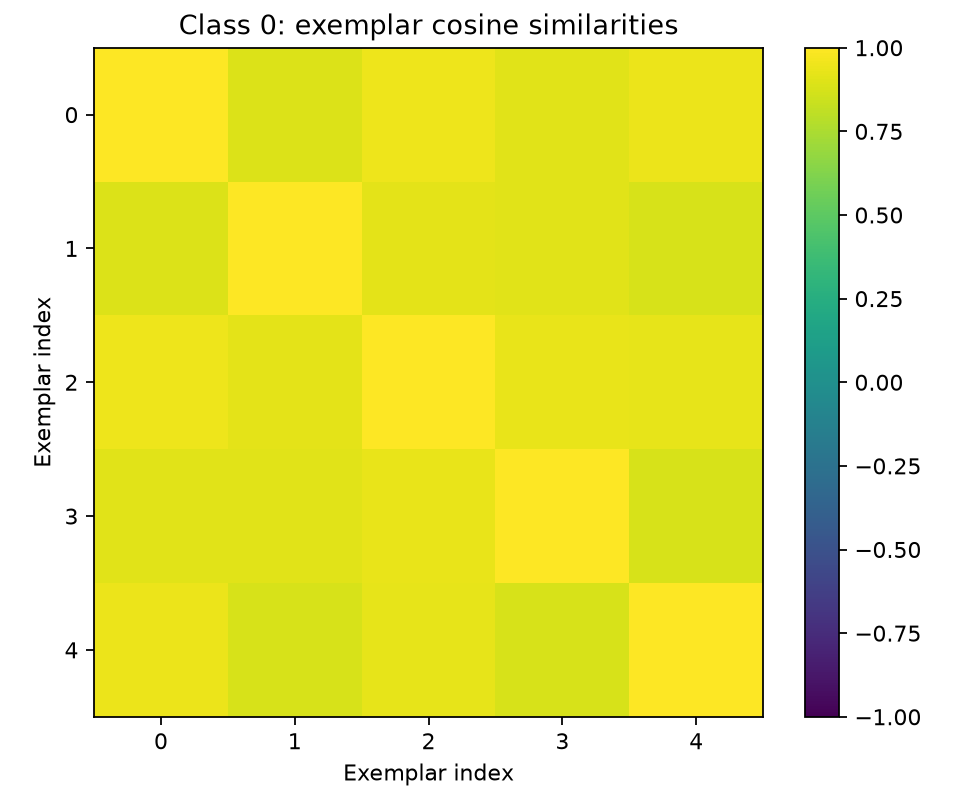
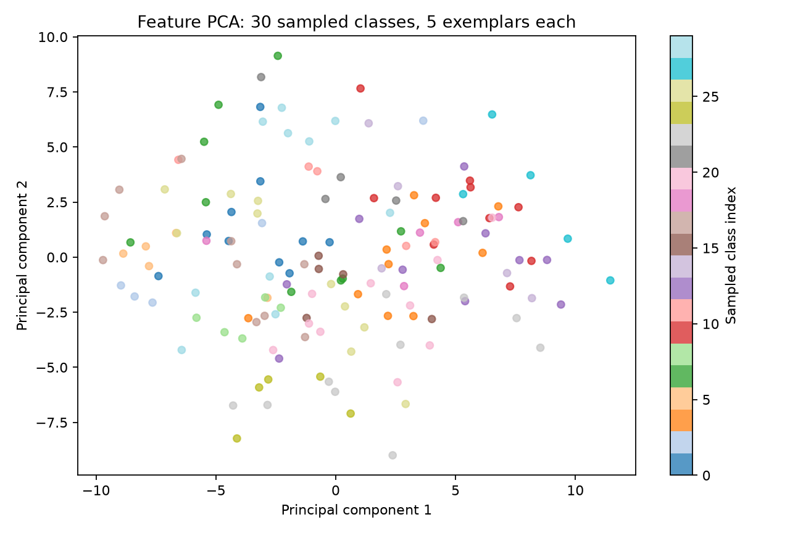
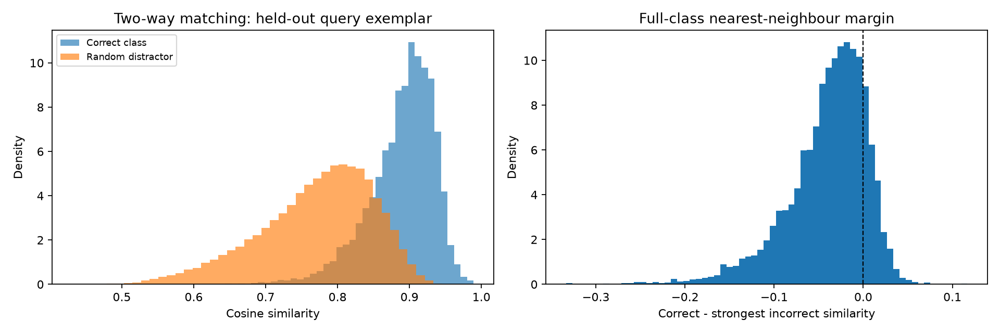

# Verified original Omniglot feature exploration

**Source:** [Singh et al. original code](https://github.com/aadityasingh/icl-dynamics), pinned submodule `external/icl-dynamics`.  
**Generated:** 2026-10-14 18:07 UTC by the repository data-audit workflow.  
**Git blob SHA-1:** `9eb588c516b641f5f25ac22227865a7ce5ab0b2f`. No neural network was trained.

## What is in the file?

| Property | Direct measurement |
| --- | --- |
| HDF5 array | `resnet18/224/feat` |
| Shape (classes × exemplars × features) | **1623 × 5 × 512** |
| Data type | `float32` |
| Feature coordinate minimum / maximum | 0.000 / 11.471 |
| Feature-coordinate standard deviation | 0.784 |
| Average L2 norm of example features | 22.457 |
| Mean within-class cosine similarity | **0.889** |
| Mean between-class cosine similarity | **0.771** |

The features are numerical ResNet18 representations, **not** raw handwritten-character images. The class order was randomised. These descriptive numbers are evidence about the *data*, not evidence of transformer induction heads or recursive model collapse.

## Visuals — actual published feature data



*Figure 1: variation in feature-vector magnitudes.*



*Figure 2: within-class and between-class cosine similarity distributions.*



*Figure 3: five exemplars from the selected class compared via cosine similarity.*



*Figure 4: unsupervised two-component PCA projection of randomly sampled classes. This is illustrative, not proof of discriminability across all features.*

## Class ordering metadata

The HDF5 also contains an array named \`class_order\`. We have inspected its numerical properties directly: 1623 entries; distinct entries: True; permutation over 0..N-1: True; identity order: False.

First ten values: [501, 752, 1520, 883, 107, 962, 679, 1265, 1211, 970]. The array may encode a permutation used during dataset preparation. Its actual mapping to the raw torchvision classes needs independent verification rather than assuming equal numerical IDs. [Full metadata](class_order.json).

## Simple data-only matching baseline

We can ask: if we choose **one reference exemplar per class** and use **another exemplar as the query**, how informative are ResNet18 features for matching? This is **not** transformer training. It is a cosine-similarity control to understand what information is already present in the input representation.

| Task | Measured data-only accuracy | Random choice |
| --- | --- | --- |
| 2-way, one-shot choice (random distractor) | **92.91%** over 50,000 sampled episodes | 50.00% |
| 1-vs-1,623 nearest-neighbour matching | **16.45%** over 6,492 queries | 0.062% |
| 1-vs-1,623 top-5 inclusion | **32.78%** | 0.31% |



*Figure 5: distribution of cosine similarities to true versus distractor classes; and retrieval margin against the strongest incorrect class. These checks use **held-out exemplars 1–4** against **first-exemplar support**. They do not prove the original induction-head algorithm is learned.*

**Assessment-safe follow-up:** [Read the split-aware explanation of Figures 2 and 5](SPLIT_AWARE_ANALYSIS.md). Its metrics use training and validation classes only, with the 100 test-class IDs excluded from model-selection diagnostics.

## Scientific interpretation and limits

1. **Feature informativeness:** within-class versus between-class similarities show whether related character instances are statistically distinguishable in the frozen ResNet18 embedding space.
2. **Representation versus algorithm:** even excellent cosine retrieval would not demonstrate contextual label copying. In the paper, numerical labels are assigned **dynamically per episode**. The transformer must read the labels *from context* rather than memorise a symbol-to-number lookup.
3. **Geometry versus collapse:** nothing in this audit tests successive synthetic model generations. We will study recursive data feedback only after deciding how the archived symbolic study is being extended.
4. **No hidden image identities:** the feature file does not provide a verified mapping back to raw image-class numbers. Original handwriting image visualisation is **not required** for the induction-head circuit or the chosen research question; the active workspace keeps Notebook 1 only.
5. **Statistical note:** many sampled episodes reuse classes/features, so the episode count must not be read as independent training-run replications.

## Inspect independently

```bash
git clone --recurse-submodules https://github.com/huziibee/nlp_ass_one.git
cd nlp_ass_one
python -m pip install -r requirements-data.txt
python scripts/check_data.py
python scripts/inspect_data.py
python scripts/feature_matching_baseline.py
jupyter lab notebooks/01_explore_omniglot.ipynb
```

**Measured raw summaries:** [summary.json](summary.json) and [matching_baselines.json](matching_baselines.json). The reproducible scripts remain under `scripts/`.
