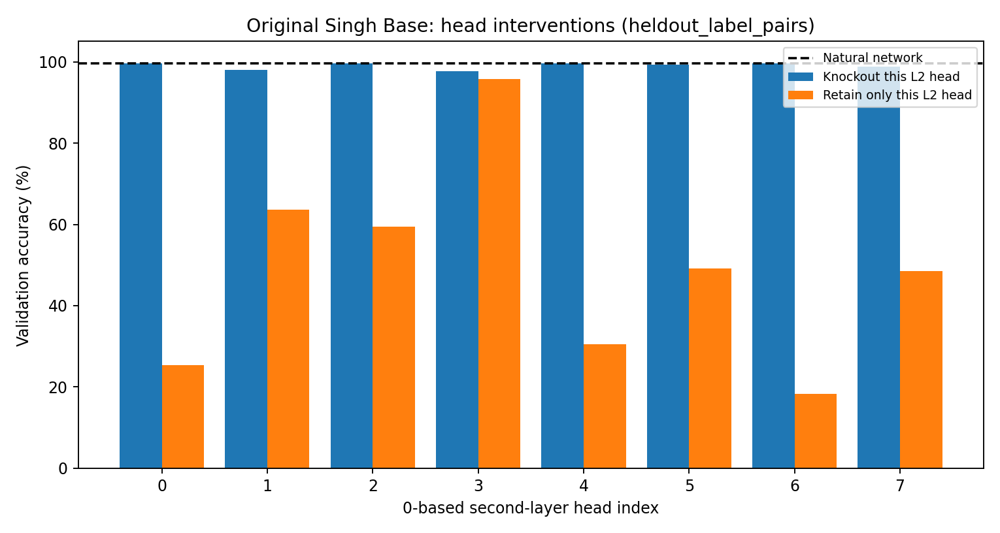
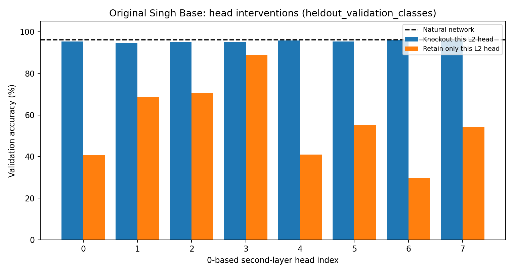

# Causal circuit analysis of the trained original Singh Base transformer

**Source:** [Successful GitHub Actions validation intervention run](https://github.com/huziibee/nlp_ass_one/actions/runs/38613565782), using checkpoint from the same repository's [1M-sequence original Base training run](https://github.com/huziibee/nlp_ass_one/actions/runs/38612082174).

## Scientific purpose

To test **whether trained attention heads contribute causally to contextual label copying**, rather than inferring circuits from raw attention maps alone. This analysis uses the researchers' own JAX \`opto.py\` framework and the unmodified trained Base model.

- **Only training and validation episodes sampled.** No reserved final test classes.
- Two separate independent **validation episode sets, each N=256**: held-out label-pair mappings on familiar classes, and reserved validation character classes with training label pairs. The earlier full training-run measurements used a different fixed sample of 512; small numerical differences are expected.
- Head indices 0–7 are **zero-based**. Layer 1 means the **second** attention layer. When retaining only one layer-1 head, the first layer is left intact.
- The target layer-1 head **3** was selected by highest natural query matching margin on a separate 256-example *training-condition* sample. Validation was subsequently used for descriptive ablation/repair analysis.

## Results (real checkpoint, original optogenetics implementation)

| Validation source | N | Natural | Knock out L2 head 3 | Retain only L2 head 3 | Force perfect match in L2 head 3 |
| --- | ---: | ---: | ---: | ---: | ---: |
| Held-out label pairs | 256 | 99.61% | 97.66% | 95.70% | 100.00% |
| Held-out validation classes | 256 | 96.09% | 94.92% | 88.67% | 100.00% |

### Head ablations — label-pair generalisation

### Head ablations — validation-class generalisation

## What does this show?

**Induction-like second-layer matching:**
The training-selected head 3 has the largest measured query attention margin in both validation settings. It is a plausible induction head: it attends more to the *correct contextual label position* than to the wrong one.

**Causal contribution with redundancy:**
Keeping only that head in the second layer retains much of the accuracy on both validation tasks. Knocking it out alone causes a smaller decrease, because other heads can contribute or compensate. Thus, a small knockout effect is **not** strong evidence that a head is unimportant. The retain-only results, together with causal head ablations, provide a more meaningful circuit picture.

**Previous-token pathway:**
Some first-layer heads strongly attend from label-token positions to immediately preceding symbol-token positions; their removal measurably harms prediction. This is consistent with the previous-token pathway required by the mechanism in Singh et al.

**Correct-match intervention:**
Replacing the selected head's query attention pattern with the *known correct contextual label position* improves accuracy to 100% on both 256-example probes. This demonstrates that the downstream computation can use a correctly supplied match to make the right prediction, but it is an **oracle intervention** and cannot be used in real inference without already knowing the correct match.

## Limits and what is NOT established

1. The model is a genuine one-million-sequence Base model, but there is **one training seed** and only 256 evaluation episodes per mechanistic probe. Report the seed and sampling uncertainty; replicate before making broad claims.
2. These interventions **causally perturb computation inside a fixed trained model**. They **do not prove** which defect in recursive synthetic training data would alter the circuit. That requires new matched training-data interventions and generations.
3. This is the **Base** task, not the Extended task. It does not yet predict a subsequent symbol or its label.
4. Head knockout, retain-only and forced-matching are interventions, not a complete unique recovered computational graph. Circuit redundancy, downstream residual paths and correlated heads remain possible.
5. The 100 final-test classes remain sealed; no post-hoc final-test head selection or accuracy claims.

## Next necessary research step

Freeze the Extended \`q2\` output-space design, implement a valid Extended G0 baseline with high validation ICL, then run matched recursion and target repairs. Compare attention/matching mechanisms across matched clean/fixed/recursive models. Only a training-data repair intervention with matched retraining can establish the proposed data-corruption-to-matching causal link.

[Raw measurements](mechanistic_dev.json) can be reprocessed and are generated by \`scripts/base_mechanistic.py\` using the pinned reference code.
