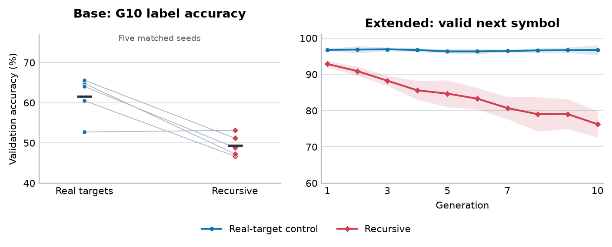

# Table 1 and Figure 1

Prerequisite: Run python scripts/run_paper.py train, then python scripts/run_paper.py results.

Status: all expected inputs are present.

Table 1 uses five matched seed pairs. Intervals are descriptive paired 95% t intervals. Figure 1 is at ../../figure1.png relative to the evidence folder; the table and figure must use the same freshly aggregated run set.

## Table 1

| Outcome | Real targets (%) | Recursive (%) | Gap (pp) | 95% paired interval (pp) |
|:--|--:|--:|--:|:--|
| Base contextual-label accuracy | 61.56 | 49.41 | 12.15 | [3.27, 21.03] |
| Extended sampled q2 validity | 96.72 | 76.25 | 20.47 | [16.61, 24.32] |

## Extended G10: retrieval and handwriting checks

These checks distinguish numerical retrieval from sampled character validity. Character identity accuracy is undefined on unseen classes.

| Seed | Targets | First label: held-out labels (%) | First label: held-out classes (%) | Valid symbol: held-out handwriting (%) | Valid symbol + second number (%) |
|:--|:--|--:|--:|--:|--:|
| 6001 | Real targets | 100.00 | 96.29 | 35.74 | 95.90 |
| 6001 | Recursive | 99.41 | 96.48 | 23.24 | 76.56 |
| 5054 | Real targets | 53.12 | 95.70 | 33.40 | 52.54 |
| 5054 | Recursive | 78.91 | 95.90 | 23.05 | 43.55 |
| 6054 | Real targets | 81.45 | 97.27 | 36.33 | 80.66 |
| 6054 | Recursive | 98.83 | 97.46 | 25.00 | 72.46 |
| 7054 | Real targets | 99.80 | 96.68 | 39.84 | 95.70 |
| 7054 | Recursive | 99.61 | 97.27 | 25.59 | 70.90 |
| 8054 | Real targets | 49.22 | 97.27 | 34.96 | 41.99 |
| 8054 | Recursive | 70.12 | 95.31 | 22.85 | 47.66 |

## Source files

- [outputs/paper_results/extended_seed_outcomes.csv](../../paper_results/extended_seed_outcomes.csv)
- [outputs/paper_results/table1.csv](../../paper_results/table1.csv)
