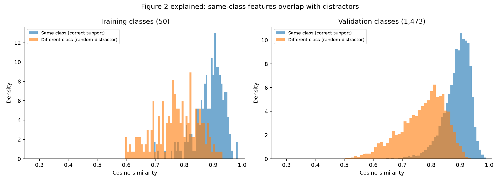
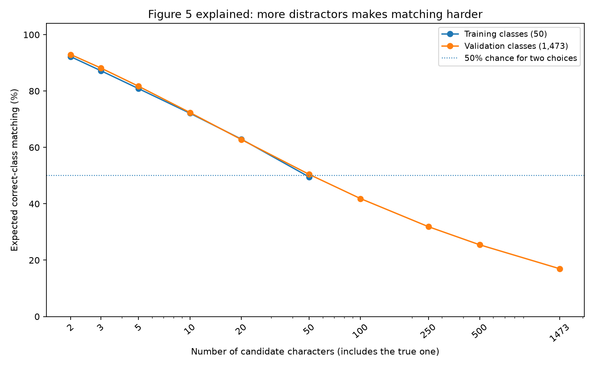

# Figures 2 and 5: a split-aware explanation

## What was measured

This report was generated using **only 50 training classes and 1,473
validation classes**. The 100 final-test classes were not scored.
The input is the official 512-dimensional Omniglot ResNet18 HDF5 from the
pinned upstream authors' repository.

For each character we use one example (exemplar 0) as the reference and
each of the other four examples (exemplars 1–4) as a query.
This is a **data-only cosine similarity measurement**, not a transformer
accuracy or induction-head intervention.

## The actual train / validation / test arrangement

| Split dimension | Train | Validation | Test |
| --- | --- | --- | --- |
| Character classes | 50 (IDs 0–49) | 1,473 (IDs 50–1,522) | 100 (IDs 1,523–1,622) |
| Exemplar IDs per class | 0 | 1–4 | None designated |
| Numeric label pairs (five possible labels) | 8 | 2 | 0 |
| Main-run evaluators from original authors | train combinations | held-out exemplar / pair, still on train classes | **test class evaluator appears in periodic original eval** |

The original source uses **four named evaluators**, but does not directly
evaluate on the 1,473-class validation pool. Moreover, its named test-class
evaluation runs periodically. For the course project, we will impose a
stricter final-test holdout that cannot guide hyperparameters. See
[Train/validation/test protocol](../TRAIN_VAL_TEST_PROTOCOL.md) and
[exact machine-readable split](reference_split_manifest.json).

Five labels give 10 unordered pairs. The original reproducible seed-20
split uses:

- Train: [[0, 4], [1, 2], [0, 1], [2, 4], [0, 2], [1, 3], [0, 3], [1, 4]]
- Validation: [[2, 3], [3, 4]]
- Test: no additional pairs in the original settings

## Figure 2: what does "same versus different" establish?

Every **correct** query-to-reference pairing comes from *two drawings of
the same Omniglot character*. Every **distractor** pairing compares the
query with a randomly selected different character.

The distribution of same-character similarity is generally farther right
than distractor similarity, meaning ResNet18 often preserves identity.
However, **overlap** means some different characters score nearly as
highly as correct ones. Having useful input embeddings does not prove a
trained attention head can read and copy contextual labels.

| Quantity | 50 training classes | 1,473 validation classes |
| --- | --- | --- |
| Measured query examples | 200 | 5892 |
| Correct/same mean cosine | 0.887 | 0.889 |
| Random-wrong mean cosine | 0.773 | 0.772 |

**Key point:** Figure 2 shows that *input matching information is present,
but imperfect*. The causal question about whether learned induction heads
fail after recursive training is a different experiment.

## Figure 5: why two choices are easier than 1,473

Given a query, always include its correct character among the candidate
reference characters, then add a uniformly chosen set of distractors.
Choose whichever reference has the largest cosine similarity.

For two candidates we need only beat **one** wrong character; for 1,473
candidates we must beat 1,472 wrong characters. Even if *most* wrong
characters score lower, one exceptionally similar impostor can beat the
correct one.

Rather than simulating a random distractor subset thousands of times,
the curve computes the **exact average probability** that none of the
sampled distractors beats the correct reference:

\`P(correct at k candidates) = C(N-1-m, k-1) / C(N-1, k-1)\`

Here N is the number of eligible classes and m is the number of
wrong-class prototypes that tie with or outscore the correct one.

| Matching condition | Training classes | Validation classes |
| --- | --- | --- |
| 2 choices (correct + 1 distractor) | **92.19%** | **92.95%** |
| All eligible classes in partition | **49.50%** (out of 50) | **16.94%** (out of 1,473) |
| Pure random choice with all eligible classes | 2.00% | 0.07% |

### Why this is worth measuring

A two-way in-context learning problem is **not** the same as a full
1,623-class recogniser. If the numeric embeddings make two-way matching
easy, learning the **algorithm that extracts the assigned number** is
the interesting transformer problem.

We need to separate:
1. **Character identity signal** already in ResNet18 representations.
2. **Query-to-context matching** performed by a learned model.
3. **Value retrieval/copying** from a symbol's position in the prompt.
4. **Changes caused by recursive synthetic training**.

Figures 2 and 5 investigate item 1. Later training/ablations must
investigate items 2–4. The figures **do not** measure collapse.

## Data leak and assessment qualifications

- These measurements use train+validation feature arrays only. The final
  100 classes (IDs 1,523–1,622) are not included.
- The class partitions are the original authors' **contiguous shuffled
  HDF5 class indices**; not named original Omniglot alphabets.
- Because a feature vector is reused across multiple comparisons,
  query-level observations are correlated, not independent model seeds.
- Candidate-selection math reports expectation over randomly sampled
  distractor subsets; it is not the original transformer's measured
  performance.
- No test accuracy, attention head, neural network, or synthetic model
  collapse result is reported here.

Data: [split_diagnostics.json](split_diagnostics.json).
